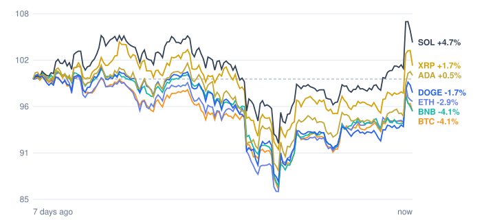

# Crypto Daily Report

An automated daily review of the crypto market. Every morning at about 09:00 (Berlin time) a
GitHub Actions workflow fetches prices from the public [CoinGecko API](https://www.coingecko.com/en/api),
writes a Markdown report with a 7-day chart, appends the numbers to a CSV history and updates this page.

The commits labelled `chore(bot): daily market report` are made by that workflow, not by hand.

## Latest report

<!-- LATEST:START -->
### 2026-11-23

- **Total crypto market cap:** €1.96 T (▼ -0.16% in 24h, measured in USD)
- **Bitcoin dominance:** 57.9%
- **Best of the tracked coins (24h):** Solana ▲ +5.04%
- **Weakest of the tracked coins (24h):** BNB ▲ +1.07%
- **Week:** 1 of 7 tracked coins are up over 7 days.

| Coin | Price | 24h | 7d | 7d range | Market cap |
|---|---:|---:|---:|---:|---:|
| Bitcoin (BTC) | €56,356.00 | ▲ +1.93% | ▼ -5.02% | €51,160.59 – €59,952.26 | €1.13 T |
| Ethereum (ETH) | €1,596.99 | ▲ +2.25% | ▼ -4.71% | €1,431.65 – €1,684.00 | €195.2 B |
| BNB (BNB) | €514.09 | ▲ +1.07% | ▼ -4.93% | €467.73 – €548.10 | €67.6 B |
| XRP (XRP) | €0.8726 | ▲ +3.09% | ▼ -0.31% | €0.7996 – €0.9201 | €55.4 B |
| Solana (SOL) | €67.31 | ▲ +5.04% | ▲ +3.09% | €60.02 – €70.16 | €39.9 B |
| Dogecoin (DOGE) | €0.0525 | ▲ +4.40% | ▼ -3.87% | €0.0472 – €0.0552 | €8.2 B |
| Cardano (ADA) | €0.1379 | ▲ +4.96% | ▼ -1.82% | €0.1237 – €0.1429 | €5.2 B |



**Recent reports:** [2026-11-23](reports/2026/11/2026-11-23.md) · [2026-11-22](reports/2026/11/2026-11-22.md) · [2026-11-21](reports/2026/11/2026-11-21.md) · [2026-11-20](reports/2026/11/2026-11-20.md) · [2026-11-19](reports/2026/11/2026-11-19.md) · [2026-11-18](reports/2026/11/2026-11-18.md) · [2026-11-17](reports/2026/11/2026-11-17.md)
<!-- LATEST:END -->

## How it works

**Trigger:** a scheduled workflow ([`.github/workflows/daily-report.yml`](.github/workflows/daily-report.yml))
starts at 07:00 and 08:00 UTC. A gate step only lets the run continue from 09:00 Berlin time, which
keeps the time right in both summer and winter. It can also be started by hand under *Actions → Run workflow*.

**Inputs:** current prices, 24h and 7-day changes and 7-day price curves for Bitcoin, Ethereum,
Solana, BNB, XRP, Cardano and Dogecoin in EUR, plus total market data.

**What happens:** the unit tests run first. Then [`report.py`](report.py) (Python standard library
only) fetches the data, builds the summary and table and draws the chart as an SVG. A second run
on the same day does nothing.

**Outputs:**

| Path | Content |
|---|---|
| `reports/YYYY/MM/YYYY-MM-DD.md` | the day's report |
| `charts/YYYY-MM-DD.svg` | 7-day performance, each coin indexed to 100 |
| `data/history.csv` | one row per coin per day, for later analysis |
| `README.md` | the latest report section above |

## Run it locally

```bash
python -m unittest discover tests
python report.py          # FORCE=1 python report.py to rebuild today's report
```

An optional free CoinGecko demo key can be added as the repository secret `COINGECKO_API_KEY`
if the public API starts rate-limiting the runner.

## Disclaimer

This is an automated data summary for learning purposes. It is not financial advice.

## License

[MIT](LICENSE)
