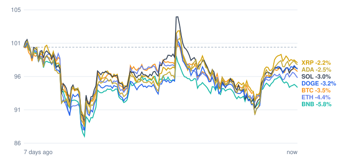

# Crypto Daily Report

An automated daily review of the crypto market. Every morning at about 09:00 (Berlin time) a
GitHub Actions workflow fetches prices from the public [CoinGecko API](https://www.coingecko.com/en/api),
writes a Markdown report with a 7-day chart, appends the numbers to a CSV history and updates this page.

The commits labelled `chore(bot): daily market report` are made by that workflow, not by hand.

## Latest report

<!-- LATEST:START -->
### 2026-11-26

- **Total crypto market cap:** €1.91 T (▲ +0.11% in 24h, measured in USD)
- **Bitcoin dominance:** 57.9%
- **Best of the tracked coins (24h):** Cardano ▲ +4.74%
- **Weakest of the tracked coins (24h):** BNB ▲ +1.48%
- **Week:** 0 of 7 tracked coins are up over 7 days.

| Coin | Price | 24h | 7d | 7d range | Market cap |
|---|---:|---:|---:|---:|---:|
| Bitcoin (BTC) | €55,123.00 | ▲ +2.42% | ▼ -4.08% | €50,783.54 – €58,062.99 | €1.11 T |
| Ethereum (ETH) | €1,542.43 | ▲ +2.21% | ▼ -5.00% | €1,421.10 – €1,645.37 | €188.6 B |
| BNB (BNB) | €502.64 | ▲ +1.48% | ▼ -5.93% | €464.28 – €534.27 | €66.1 B |
| XRP (XRP) | €0.8661 | ▲ +3.79% | ▼ -1.99% | €0.7937 – €0.9036 | €55.0 B |
| Solana (SOL) | €64.64 | ▲ +3.44% | ▼ -3.56% | €59.57 – €69.64 | €38.3 B |
| Dogecoin (DOGE) | €0.0517 | ▲ +4.21% | ▼ -3.20% | €0.0469 – €0.0537 | €8.1 B |
| Cardano (ADA) | €0.1357 | ▲ +4.74% | ▼ -2.41% | €0.1228 – €0.1404 | €5.1 B |



**Recent reports:** [2026-11-26](reports/2026/11/2026-11-26.md) · [2026-11-25](reports/2026/11/2026-11-25.md) · [2026-11-24](reports/2026/11/2026-11-24.md) · [2026-11-23](reports/2026/11/2026-11-23.md) · [2026-11-22](reports/2026/11/2026-11-22.md) · [2026-11-21](reports/2026/11/2026-11-21.md) · [2026-11-20](reports/2026/11/2026-11-20.md)
<!-- LATEST:END -->

## How it works

**Trigger:** a scheduled workflow ([`.github/workflows/daily-report.yml`](.github/workflows/daily-report.yml))
starts at 07:00 and 08:00 UTC. A gate step only lets the run continue from 09:00 Berlin time, which
keeps the time right in both summer and winter. It can also be started by hand under *Actions → Run workflow*.

**Inputs:** current prices, 24h and 7-day changes and 7-day price curves for Bitcoin, Ethereum,
Solana, BNB, XRP, Cardano and Dogecoin in EUR, plus total market data.

**What happens:** the unit tests run first. Then [`report.py`](report.py) (Python standard library
only) fetches the data, builds the summary and table and draws the chart as an SVG. A second run
on the same day does nothing.

**Outputs:**

| Path | Content |
|---|---|
| `reports/YYYY/MM/YYYY-MM-DD.md` | the day's report |
| `charts/YYYY-MM-DD.svg` | 7-day performance, each coin indexed to 100 |
| `data/history.csv` | one row per coin per day, for later analysis |
| `README.md` | the latest report section above |

## Run it locally

```bash
python -m unittest discover tests
python report.py          # FORCE=1 python report.py to rebuild today's report
```

An optional free CoinGecko demo key can be added as the repository secret `COINGECKO_API_KEY`
if the public API starts rate-limiting the runner.

## Disclaimer

This is an automated data summary for learning purposes. It is not financial advice.

## License

[MIT](LICENSE)
