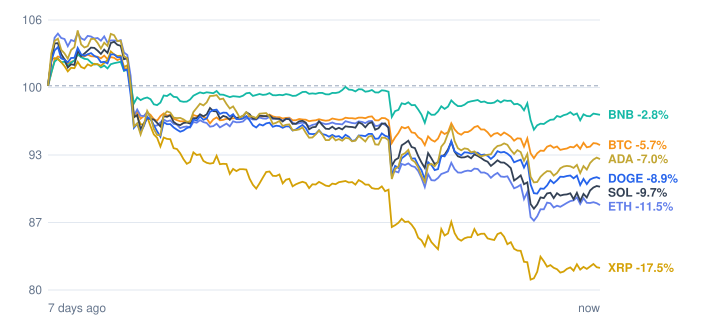

# Crypto Daily Report

An automated daily review of the crypto market. Every morning at about 09:00 (Berlin time) a
GitHub Actions workflow fetches prices from the public [CoinGecko API](https://www.coingecko.com/en/api),
writes a Markdown report with a 7-day chart, appends the numbers to a CSV history and updates this page.

The commits labelled `chore(bot): daily market report` are made by that workflow, not by hand.

## Latest report

<!-- LATEST:START -->
### 2026-11-11

- **Total crypto market cap:** €2.24 T (▼ -2.92% in 24h, measured in USD)
- **Bitcoin dominance:** 59.7%
- **Best of the tracked coins (24h):** Solana ▲ +1.21%
- **Weakest of the tracked coins (24h):** Dogecoin ▼ -0.25%
- **Week:** 0 of 7 tracked coins are up over 7 days.

| Coin | Price | 24h | 7d | 7d range | Market cap |
|---|---:|---:|---:|---:|---:|
| Bitcoin (BTC) | €66,409.00 | ▲ +0.32% | ▼ -5.72% | €65,694.88 – €72,755.69 | €1.33 T |
| Ethereum (ETH) | €1,854.12 | ▲ +0.06% | ▼ -11.13% | €1,818.99 – €2,196.02 | €226.4 B |
| BNB (BNB) | €614.04 | ▲ +0.05% | ▼ -2.44% | €604.80 – €650.65 | €80.7 B |
| XRP (XRP) | €0.9536 | ▲ +0.64% | ▼ -17.01% | €0.9403 – €1.19 | €60.5 B |
| Solana (SOL) | €75.96 | ▲ +1.21% | ▼ -8.75% | €73.86 – €87.29 | €44.9 B |
| Dogecoin (DOGE) | €0.0615 | ▼ -0.25% | ▼ -8.47% | €0.0604 – €0.0699 | €9.6 B |
| Cardano (ADA) | €0.1595 | ▲ +1.17% | ▼ -6.36% | €0.1552 – €0.1802 | €6.0 B |



**Recent reports:** [2026-11-11](reports/2026/11/2026-11-11.md) · [2026-11-10](reports/2026/11/2026-11-10.md) · [2026-11-09](reports/2026/11/2026-11-09.md) · [2026-11-08](reports/2026/11/2026-11-08.md) · [2026-11-07](reports/2026/11/2026-11-07.md) · [2026-11-06](reports/2026/11/2026-11-06.md) · [2026-11-05](reports/2026/11/2026-11-05.md)
<!-- LATEST:END -->

## How it works

**Trigger:** a scheduled workflow ([`.github/workflows/daily-report.yml`](.github/workflows/daily-report.yml))
starts at 07:00 and 08:00 UTC. A gate step only lets the run continue from 09:00 Berlin time, which
keeps the time right in both summer and winter. It can also be started by hand under *Actions → Run workflow*.

**Inputs:** current prices, 24h and 7-day changes and 7-day price curves for Bitcoin, Ethereum,
Solana, BNB, XRP, Cardano and Dogecoin in EUR, plus total market data.

**What happens:** the unit tests run first. Then [`report.py`](report.py) (Python standard library
only) fetches the data, builds the summary and table and draws the chart as an SVG. A second run
on the same day does nothing.

**Outputs:**

| Path | Content |
|---|---|
| `reports/YYYY/MM/YYYY-MM-DD.md` | the day's report |
| `charts/YYYY-MM-DD.svg` | 7-day performance, each coin indexed to 100 |
| `data/history.csv` | one row per coin per day, for later analysis |
| `README.md` | the latest report section above |

## Run it locally

```bash
python -m unittest discover tests
python report.py          # FORCE=1 python report.py to rebuild today's report
```

An optional free CoinGecko demo key can be added as the repository secret `COINGECKO_API_KEY`
if the public API starts rate-limiting the runner.

## Disclaimer

This is an automated data summary for learning purposes. It is not financial advice.

## License

[MIT](LICENSE)
