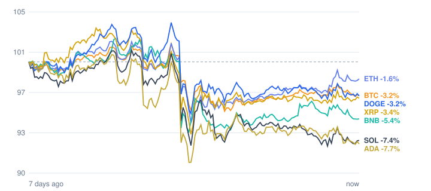

# Crypto Daily Report

An automated daily review of the crypto market. Every morning at about 09:00 (Berlin time) a
GitHub Actions workflow fetches prices from the public [CoinGecko API](https://www.coingecko.com/en/api),
writes a Markdown report with a 7-day chart, appends the numbers to a CSV history and updates this page.

The commits labelled `chore(bot): daily market report` are made by that workflow, not by hand.

## Latest report

<!-- LATEST:START -->
### 2026-11-02

- **Total crypto market cap:** €2.34 T (▼ -2.19% in 24h, measured in USD)
- **Bitcoin dominance:** 59.3%
- **Best of the tracked coins (24h):** XRP ▲ +0.10%
- **Weakest of the tracked coins (24h):** Cardano ▼ -1.38%
- **Week:** 0 of 7 tracked coins are up over 7 days.

| Coin | Price | 24h | 7d | 7d range | Market cap |
|---|---:|---:|---:|---:|---:|
| Bitcoin (BTC) | €69,094.00 | ▼ -0.75% | ▼ -3.59% | €68,391.75 – €72,951.01 | €1.39 T |
| Ethereum (ETH) | €2,025.09 | ▲ +0.10% | ▼ -2.29% | €1,957.14 – €2,116.40 | €247.4 B |
| BNB (BNB) | €626.31 | ▼ -1.32% | ▼ -5.86% | €620.45 – €678.70 | €82.4 B |
| XRP (XRP) | €1.12 | ▲ +0.10% | ▼ -4.13% | €1.08 – €1.19 | €70.7 B |
| Solana (SOL) | €83.35 | ▼ -1.30% | ▼ -8.52% | €83.69 – €91.90 | €49.2 B |
| Dogecoin (DOGE) | €0.0669 | ▼ -0.84% | ▼ -3.67% | €0.0660 – €0.0719 | €10.5 B |
| Cardano (ADA) | €0.1698 | ▼ -1.38% | ▼ -8.01% | €0.1668 – €0.1855 | €6.4 B |



**Recent reports:** [2026-11-02](reports/2026/11/2026-11-02.md) · [2026-11-01](reports/2026/11/2026-11-01.md) · [2026-10-31](reports/2026/10/2026-10-31.md) · [2026-10-30](reports/2026/10/2026-10-30.md) · [2026-10-29](reports/2026/10/2026-10-29.md) · [2026-10-28](reports/2026/10/2026-10-28.md)
<!-- LATEST:END -->

## How it works

**Trigger:** a scheduled workflow ([`.github/workflows/daily-report.yml`](.github/workflows/daily-report.yml))
starts at 07:00 and 08:00 UTC. A gate step only lets the run continue from 09:00 Berlin time, which
keeps the time right in both summer and winter. It can also be started by hand under *Actions → Run workflow*.

**Inputs:** current prices, 24h and 7-day changes and 7-day price curves for Bitcoin, Ethereum,
Solana, BNB, XRP, Cardano and Dogecoin in EUR, plus total market data.

**What happens:** the unit tests run first. Then [`report.py`](report.py) (Python standard library
only) fetches the data, builds the summary and table and draws the chart as an SVG. A second run
on the same day does nothing.

**Outputs:**

| Path | Content |
|---|---|
| `reports/YYYY/MM/YYYY-MM-DD.md` | the day's report |
| `charts/YYYY-MM-DD.svg` | 7-day performance, each coin indexed to 100 |
| `data/history.csv` | one row per coin per day, for later analysis |
| `README.md` | the latest report section above |

## Run it locally

```bash
python -m unittest discover tests
python report.py          # FORCE=1 python report.py to rebuild today's report
```

An optional free CoinGecko demo key can be added as the repository secret `COINGECKO_API_KEY`
if the public API starts rate-limiting the runner.

## Disclaimer

This is an automated data summary for learning purposes. It is not financial advice.

## License

[MIT](LICENSE)
