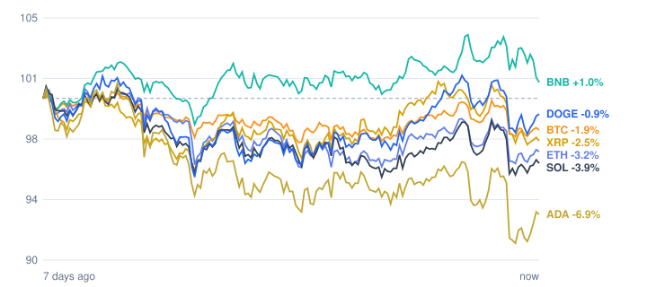

# Crypto market review: 2026-10-29

Snapshot taken 2026-10-29 14:50 (Europe/Berlin). Prices in EUR from CoinGecko.

## Summary

- **Total crypto market cap:** €2.43 T (▼ -3.23% in 24h, measured in USD)
- **Bitcoin dominance:** 59.4%
- **Best of the tracked coins (24h):** Dogecoin ▲ +0.47%
- **Weakest of the tracked coins (24h):** XRP ▼ -1.82%
- **Week:** 1 of 7 tracked coins are up over 7 days.

## Tracked coins

| Coin | Price | 24h | 7d | 7d range | Market cap |
|---|---:|---:|---:|---:|---:|
| Bitcoin (BTC) | €71,958.00 | ▼ -0.29% | ▼ -2.13% | €71,484.85 – €73,647.28 | €1.45 T |
| Ethereum (ETH) | €2,084.98 | ▼ -0.15% | ▼ -3.28% | €2,068.92 – €2,169.91 | €254.7 B |
| BNB (BNB) | €668.09 | ▼ -0.52% | ▲ +1.08% | €648.35 – €683.48 | €87.9 B |
| XRP (XRP) | €1.16 | ▼ -1.82% | ▼ -2.78% | €1.14 – €1.20 | €73.3 B |
| Solana (SOL) | €90.24 | ▼ -0.37% | ▼ -3.81% | €89.41 – €94.48 | €53.2 B |
| Dogecoin (DOGE) | €0.0710 | ▲ +0.47% | ▼ -0.51% | €0.0680 – €0.0723 | €11.1 B |
| Cardano (ADA) | €0.1810 | ▼ -0.18% | ▼ -7.21% | €0.1774 – €0.1959 | €6.8 B |

## Last 7 days (indexed to 100)

---
*Automated data summary. Not financial advice.*
