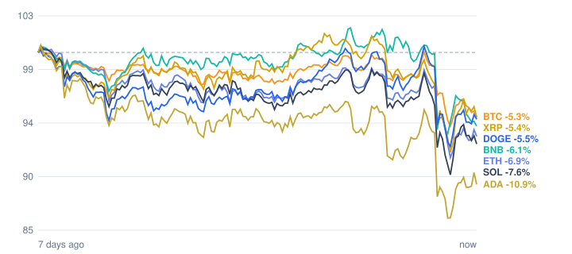

# Crypto market review: 2026-10-30

Snapshot taken 2026-10-30 14:43 (Europe/Berlin). Prices in EUR from CoinGecko.

## Summary

- **Total crypto market cap:** €2.34 T (▼ -5.85% in 24h, measured in USD)
- **Bitcoin dominance:** 59.2%
- **Best of the tracked coins (24h):** Bitcoin ▼ -3.92%
- **Weakest of the tracked coins (24h):** BNB ▼ -6.46%
- **Week:** 0 of 7 tracked coins are up over 7 days.

## Tracked coins

| Coin | Price | 24h | 7d | 7d range | Market cap |
|---|---:|---:|---:|---:|---:|
| Bitcoin (BTC) | €69,079.00 | ▼ -3.92% | ▼ -5.28% | €68,682.08 – €73,365.66 | €1.39 T |
| Ethereum (ETH) | €1,993.22 | ▼ -4.34% | ▼ -7.02% | €1,963.39 – €2,160.08 | €243.5 B |
| BNB (BNB) | €624.69 | ▼ -6.46% | ▼ -6.24% | €622.43 – €680.86 | €82.2 B |
| XRP (XRP) | €1.11 | ▼ -4.17% | ▼ -5.54% | €1.08 – €1.20 | €70.3 B |
| Solana (SOL) | €85.43 | ▼ -5.28% | ▼ -7.34% | €84.01 – €94.01 | €50.4 B |
| Dogecoin (DOGE) | €0.0676 | ▼ -4.78% | ▼ -5.41% | €0.0662 – €0.0722 | €10.6 B |
| Cardano (ADA) | €0.1716 | ▼ -5.07% | ▼ -10.94% | €0.1673 – €0.1951 | €6.4 B |

## Last 7 days (indexed to 100)

---
*Automated data summary. Not financial advice.*
