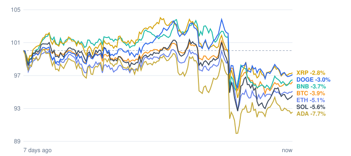

# Crypto market review: 2026-10-31

Snapshot taken 2026-10-31 14:12 (Europe/Berlin). Prices in EUR from CoinGecko.

## Summary

- **Total crypto market cap:** €2.35 T (▼ -2.49% in 24h, measured in USD)
- **Bitcoin dominance:** 59.2%
- **Best of the tracked coins (24h):** Ethereum ▲ +0.67%
- **Weakest of the tracked coins (24h):** Solana ▼ -0.97%
- **Week:** 0 of 7 tracked coins are up over 7 days.

## Tracked coins

| Coin | Price | 24h | 7d | 7d range | Market cap |
|---|---:|---:|---:|---:|---:|
| Bitcoin (BTC) | €69,155.00 | ▲ +0.08% | ▼ -3.78% | €68,182.32 – €72,942.90 | €1.39 T |
| Ethereum (ETH) | €2,005.52 | ▲ +0.67% | ▼ -4.77% | €1,956.92 – €2,116.17 | €245.0 B |
| BNB (BNB) | €629.77 | ▲ +0.62% | ▼ -3.51% | €620.38 – €678.62 | €82.8 B |
| XRP (XRP) | €1.11 | ▲ +0.14% | ▼ -2.48% | €1.08 – €1.19 | €70.5 B |
| Solana (SOL) | €85.51 | ▼ -0.97% | ▼ -5.36% | €83.74 – €91.89 | €50.5 B |
| Dogecoin (DOGE) | €0.0672 | ▼ -0.65% | ▼ -2.87% | €0.0660 – €0.0719 | €10.5 B |
| Cardano (ADA) | €0.1719 | ▼ -0.21% | ▼ -7.45% | €0.1668 – €0.1865 | €6.5 B |

## Last 7 days (indexed to 100)

---
*Automated data summary. Not financial advice.*
