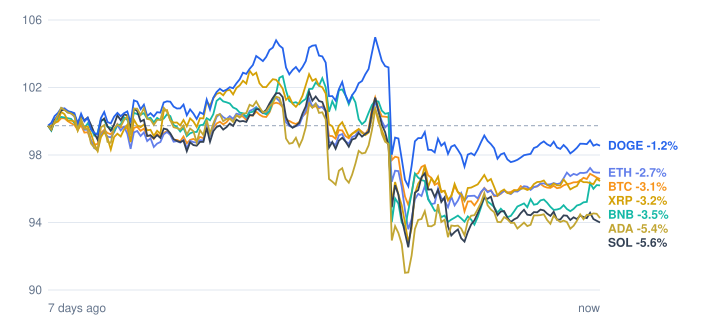

# Crypto market review: 2026-11-01

Snapshot taken 2026-11-01 14:55 (Europe/Berlin). Prices in EUR from CoinGecko.

## Summary

- **Total crypto market cap:** €2.35 T (▼ -2.18% in 24h, measured in USD)
- **Bitcoin dominance:** 59.3%
- **Best of the tracked coins (24h):** BNB ▲ +1.55%
- **Weakest of the tracked coins (24h):** Solana ▼ -1.04%
- **Week:** 0 of 7 tracked coins are up over 7 days.

## Tracked coins

| Coin | Price | 24h | 7d | 7d range | Market cap |
|---|---:|---:|---:|---:|---:|
| Bitcoin (BTC) | €69,531.00 | ▲ +0.50% | ▼ -3.34% | €68,181.88 – €72,942.43 | €1.40 T |
| Ethereum (ETH) | €2,022.87 | ▲ +0.66% | ▼ -3.31% | €1,956.91 – €2,116.15 | €247.1 B |
| BNB (BNB) | €638.17 | ▲ +1.55% | ▼ -4.08% | €620.38 – €678.62 | €83.9 B |
| XRP (XRP) | €1.12 | ▲ +0.26% | ▼ -3.86% | €1.08 – €1.19 | €70.8 B |
| Solana (SOL) | €84.64 | ▼ -1.04% | ▼ -6.37% | €83.74 – €91.89 | €50.0 B |
| Dogecoin (DOGE) | €0.0676 | ▲ +0.41% | ▼ -1.49% | €0.0660 – €0.0719 | €10.6 B |
| Cardano (ADA) | €0.1726 | ▲ +0.36% | ▼ -5.91% | €0.1668 – €0.1855 | €6.5 B |

## Last 7 days (indexed to 100)

---
*Automated data summary. Not financial advice.*
