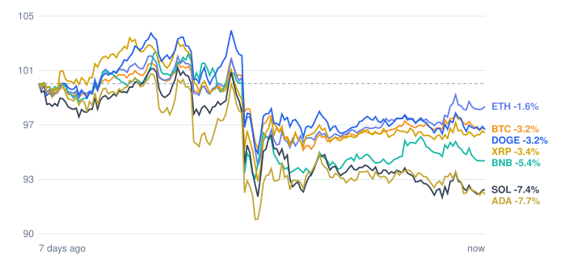

# Crypto market review: 2026-11-02

Snapshot taken 2026-11-02 17:41 (Europe/Berlin). Prices in EUR from CoinGecko.

## Summary

- **Total crypto market cap:** €2.34 T (▼ -2.19% in 24h, measured in USD)
- **Bitcoin dominance:** 59.3%
- **Best of the tracked coins (24h):** XRP ▲ +0.10%
- **Weakest of the tracked coins (24h):** Cardano ▼ -1.38%
- **Week:** 0 of 7 tracked coins are up over 7 days.

## Tracked coins

| Coin | Price | 24h | 7d | 7d range | Market cap |
|---|---:|---:|---:|---:|---:|
| Bitcoin (BTC) | €69,094.00 | ▼ -0.75% | ▼ -3.59% | €68,391.75 – €72,951.01 | €1.39 T |
| Ethereum (ETH) | €2,025.09 | ▲ +0.10% | ▼ -2.29% | €1,957.14 – €2,116.40 | €247.4 B |
| BNB (BNB) | €626.31 | ▼ -1.32% | ▼ -5.86% | €620.45 – €678.70 | €82.4 B |
| XRP (XRP) | €1.12 | ▲ +0.10% | ▼ -4.13% | €1.08 – €1.19 | €70.7 B |
| Solana (SOL) | €83.35 | ▼ -1.30% | ▼ -8.52% | €83.69 – €91.90 | €49.2 B |
| Dogecoin (DOGE) | €0.0669 | ▼ -0.84% | ▼ -3.67% | €0.0660 – €0.0719 | €10.5 B |
| Cardano (ADA) | €0.1698 | ▼ -1.38% | ▼ -8.01% | €0.1668 – €0.1855 | €6.4 B |

## Last 7 days (indexed to 100)

---
*Automated data summary. Not financial advice.*
