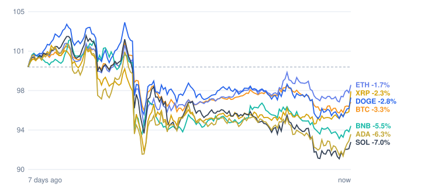

# Crypto market review: 2026-11-03

Snapshot taken 2026-11-03 15:44 (Europe/Berlin). Prices in EUR from CoinGecko.

## Summary

- **Total crypto market cap:** €2.34 T (▼ -3.15% in 24h, measured in USD)
- **Bitcoin dominance:** 59.2%
- **Best of the tracked coins (24h):** XRP ▲ +2.38%
- **Weakest of the tracked coins (24h):** Solana ▼ -0.64%
- **Week:** 0 of 7 tracked coins are up over 7 days.

## Tracked coins

| Coin | Price | 24h | 7d | 7d range | Market cap |
|---|---:|---:|---:|---:|---:|
| Bitcoin (BTC) | €69,108.00 | ▼ -0.37% | ▼ -3.63% | €68,374.55 – €73,025.92 | €1.39 T |
| Ethereum (ETH) | €2,044.65 | ▲ +0.26% | ▼ -1.98% | €1,959.15 – €2,118.58 | €249.8 B |
| BNB (BNB) | €623.64 | ▼ -0.62% | ▼ -5.95% | €618.11 – €679.39 | €82.0 B |
| XRP (XRP) | €1.14 | ▲ +2.38% | ▼ -2.14% | €1.08 – €1.20 | €72.4 B |
| Solana (SOL) | €83.48 | ▼ -0.64% | ▼ -7.53% | €81.72 – €91.99 | €49.3 B |
| Dogecoin (DOGE) | €0.0672 | ▲ +0.26% | ▼ -3.42% | €0.0658 – €0.0720 | €10.5 B |
| Cardano (ADA) | €0.1704 | ▲ +0.45% | ▼ -7.01% | €0.1666 – €0.1857 | €6.4 B |

## Last 7 days (indexed to 100)

---
*Automated data summary. Not financial advice.*
