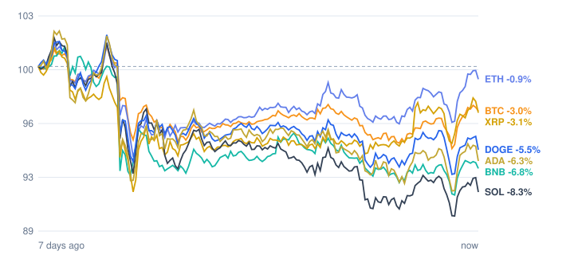

# Crypto market review: 2026-11-04

Snapshot taken 2026-11-04 15:57 (Europe/Berlin). Prices in EUR from CoinGecko.

## Summary

- **Total crypto market cap:** €2.38 T (▼ -0.28% in 24h, measured in USD)
- **Bitcoin dominance:** 59.4%
- **Best of the tracked coins (24h):** Ethereum ▲ +3.17%
- **Weakest of the tracked coins (24h):** BNB ▲ +0.92%
- **Week:** 0 of 7 tracked coins are up over 7 days.

## Tracked coins

| Coin | Price | 24h | 7d | 7d range | Market cap |
|---|---:|---:|---:|---:|---:|
| Bitcoin (BTC) | €70,371.00 | ▲ +1.96% | ▼ -2.94% | €67,742.61 – €72,626.24 | €1.41 T |
| Ethereum (ETH) | €2,105.29 | ▲ +3.17% | ▼ -0.86% | €1,948.42 – €2,106.29 | €257.2 B |
| BNB (BNB) | €629.11 | ▲ +0.92% | ▼ -7.13% | €609.25 – €674.84 | €82.7 B |
| XRP (XRP) | €1.16 | ▲ +2.01% | ▼ -2.58% | €1.07 – €1.19 | €73.7 B |
| Solana (SOL) | €84.31 | ▲ +1.18% | ▼ -8.48% | €80.85 – €91.49 | €49.8 B |
| Dogecoin (DOGE) | €0.0679 | ▲ +1.20% | ▼ -5.62% | €0.0651 – €0.0716 | €10.6 B |
| Cardano (ADA) | €0.1735 | ▲ +2.01% | ▼ -6.43% | €0.1648 – €0.1839 | €6.5 B |

## Last 7 days (indexed to 100)

---
*Automated data summary. Not financial advice.*
