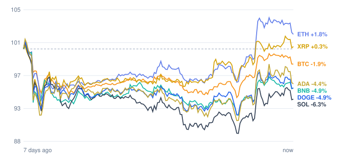

# Crypto market review: 2026-11-05

Snapshot taken 2026-11-05 16:02 (Europe/Berlin). Prices in EUR from CoinGecko.

## Summary

- **Total crypto market cap:** €2.35 T (▼ -2.49% in 24h, measured in USD)
- **Bitcoin dominance:** 59.4%
- **Best of the tracked coins (24h):** BNB ▼ -0.91%
- **Weakest of the tracked coins (24h):** Cardano ▼ -3.45%
- **Week:** 1 of 7 tracked coins are up over 7 days.

## Tracked coins

| Coin | Price | 24h | 7d | 7d range | Market cap |
|---|---:|---:|---:|---:|---:|
| Bitcoin (BTC) | €69,625.00 | ▼ -1.31% | ▼ -2.53% | €67,942.27 – €72,840.29 | €1.40 T |
| Ethereum (ETH) | €2,083.60 | ▼ -1.93% | ▲ +0.67% | €1,954.17 – €2,171.04 | €254.8 B |
| BNB (BNB) | €625.24 | ▼ -0.91% | ▼ -5.66% | €611.05 – €668.17 | €82.3 B |
| XRP (XRP) | €1.14 | ▼ -2.97% | ▼ -0.78% | €1.08 – €1.18 | €72.3 B |
| Solana (SOL) | €82.75 | ▼ -2.43% | ▼ -7.60% | €81.09 – €91.46 | €48.9 B |
| Dogecoin (DOGE) | €0.0660 | ▼ -3.43% | ▼ -6.32% | €0.0653 – €0.0718 | €10.3 B |
| Cardano (ADA) | €0.1689 | ▼ -3.45% | ▼ -5.95% | €0.1653 – €0.1839 | €6.4 B |

## Last 7 days (indexed to 100)

---
*Automated data summary. Not financial advice.*
