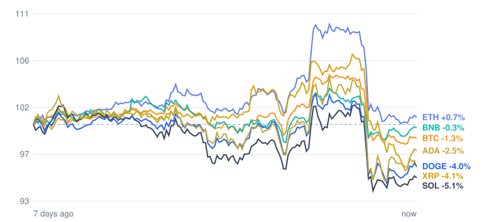

# Crypto market review: 2026-11-06

Snapshot taken 2026-11-06 15:41 (Europe/Berlin). Prices in EUR from CoinGecko.

## Summary

- **Total crypto market cap:** €2.31 T (▼ -6.85% in 24h, measured in USD)
- **Bitcoin dominance:** 59.1%
- **Best of the tracked coins (24h):** BNB ▼ -0.63%
- **Weakest of the tracked coins (24h):** XRP ▼ -7.48%
- **Week:** 1 of 7 tracked coins are up over 7 days.

## Tracked coins

| Coin | Price | 24h | 7d | 7d range | Market cap |
|---|---:|---:|---:|---:|---:|
| Bitcoin (BTC) | €67,900.00 | ▼ -3.53% | ▼ -2.03% | €67,771.05 – €72,374.01 | €1.36 T |
| Ethereum (ETH) | €2,004.55 | ▼ -4.88% | ▲ +0.11% | €1,993.15 – €2,184.50 | €244.9 B |
| BNB (BNB) | €624.41 | ▼ -0.63% | ▼ -0.65% | €614.84 – €647.24 | €82.1 B |
| XRP (XRP) | €1.06 | ▼ -7.48% | ▼ -4.88% | €1.06 – €1.19 | €67.5 B |
| Solana (SOL) | €81.32 | ▼ -3.13% | ▼ -6.70% | €79.81 – €86.83 | €48.0 B |
| Dogecoin (DOGE) | €0.0652 | ▼ -2.24% | ▼ -4.59% | €0.0638 – €0.0696 | €10.2 B |
| Cardano (ADA) | €0.1683 | ▼ -1.45% | ▼ -3.34% | €0.1621 – €0.1793 | €6.3 B |

## Last 7 days (indexed to 100)

---
*Automated data summary. Not financial advice.*
