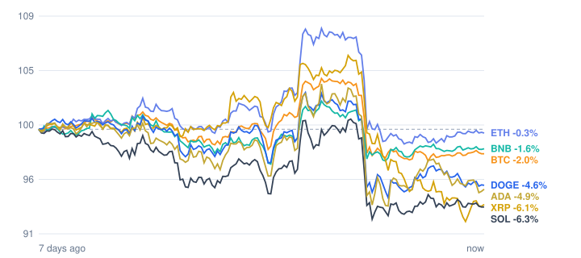

# Crypto market review: 2026-11-07

Snapshot taken 2026-11-07 14:39 (Europe/Berlin). Prices in EUR from CoinGecko.

## Summary

- **Total crypto market cap:** €2.30 T (▼ -2.83% in 24h, measured in USD)
- **Bitcoin dominance:** 59.3%
- **Best of the tracked coins (24h):** Ethereum ▲ +0.58%
- **Weakest of the tracked coins (24h):** Cardano ▼ -1.86%
- **Week:** 0 of 7 tracked coins are up over 7 days.

## Tracked coins

| Coin | Price | 24h | 7d | 7d range | Market cap |
|---|---:|---:|---:|---:|---:|
| Bitcoin (BTC) | €68,040.00 | ▲ +0.27% | ▼ -2.20% | €67,697.19 – €72,372.04 | €1.37 T |
| Ethereum (ETH) | €2,010.52 | ▲ +0.58% | ▼ -0.30% | €1,994.57 – €2,184.44 | €245.7 B |
| BNB (BNB) | €623.39 | ▲ +0.09% | ▼ -1.53% | €614.82 – €647.22 | €82.0 B |
| XRP (XRP) | €1.04 | ▼ -1.45% | ▼ -6.99% | €1.04 – €1.19 | €66.4 B |
| Solana (SOL) | €80.62 | ▼ -0.33% | ▼ -6.40% | €79.81 – €86.83 | €47.6 B |
| Dogecoin (DOGE) | €0.0645 | ▼ -0.55% | ▼ -4.59% | €0.0638 – €0.0696 | €10.1 B |
| Cardano (ADA) | €0.1639 | ▼ -1.86% | ▼ -5.20% | €0.1621 – €0.1793 | €6.2 B |

## Last 7 days (indexed to 100)

---
*Automated data summary. Not financial advice.*
