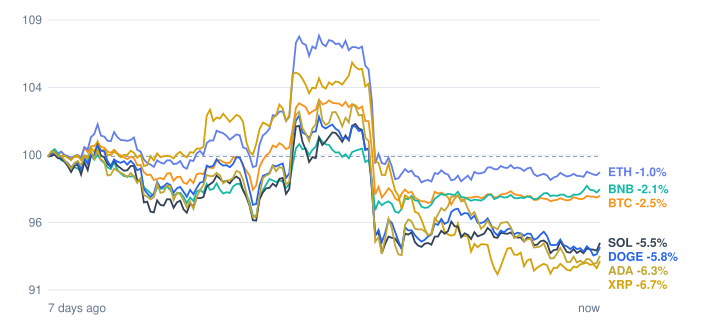

# Crypto market review: 2026-11-08

Snapshot taken 2026-11-08 14:57 (Europe/Berlin). Prices in EUR from CoinGecko.

## Summary

- **Total crypto market cap:** €2.27 T (▼ -3.59% in 24h, measured in USD)
- **Bitcoin dominance:** 60.0%
- **Best of the tracked coins (24h):** BNB ▲ +0.16%
- **Weakest of the tracked coins (24h):** Cardano ▼ -1.76%
- **Week:** 0 of 7 tracked coins are up over 7 days.

## Tracked coins

| Coin | Price | 24h | 7d | 7d range | Market cap |
|---|---:|---:|---:|---:|---:|
| Bitcoin (BTC) | €67,997.00 | ▼ -0.08% | ▼ -2.61% | €67,675.82 – €72,349.19 | €1.37 T |
| Ethereum (ETH) | €2,003.24 | ▼ -0.44% | ▼ -1.39% | €1,993.94 – €2,183.75 | €244.8 B |
| BNB (BNB) | €624.41 | ▲ +0.16% | ▼ -2.13% | €614.63 – €647.02 | €82.1 B |
| XRP (XRP) | €1.04 | ▼ -0.54% | ▼ -7.25% | €1.04 – €1.19 | €66.0 B |
| Solana (SOL) | €79.92 | ▼ -0.90% | ▼ -6.05% | €79.78 – €86.80 | €47.2 B |
| Dogecoin (DOGE) | €0.0638 | ▼ -1.07% | ▼ -5.98% | €0.0635 – €0.0696 | €10.0 B |
| Cardano (ADA) | €0.1610 | ▼ -1.76% | ▼ -6.78% | €0.1611 – €0.1792 | €6.0 B |

## Last 7 days (indexed to 100)

---
*Automated data summary. Not financial advice.*
