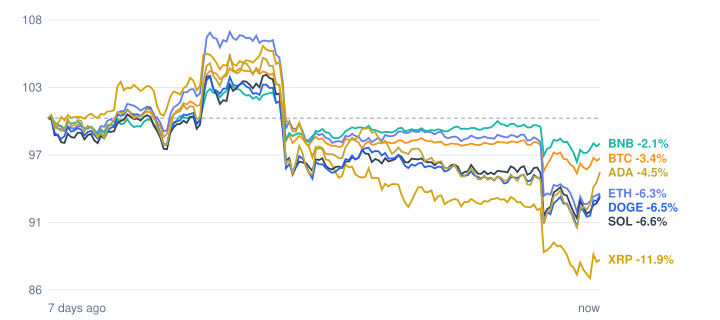

# Crypto market review: 2026-11-09

Snapshot taken 2026-11-09 17:58 (Europe/Berlin). Prices in EUR from CoinGecko.

## Summary

- **Total crypto market cap:** €2.25 T (▼ -3.19% in 24h, measured in USD)
- **Bitcoin dominance:** 59.6%
- **Best of the tracked coins (24h):** Cardano ▼ -0.15%
- **Weakest of the tracked coins (24h):** XRP ▼ -5.08%
- **Week:** 0 of 7 tracked coins are up over 7 days.

## Tracked coins

| Coin | Price | 24h | 7d | 7d range | Market cap |
|---|---:|---:|---:|---:|---:|
| Bitcoin (BTC) | €66,946.00 | ▼ -1.38% | ▼ -2.96% | €65,896.79 – €72,002.11 | €1.35 T |
| Ethereum (ETH) | €1,903.85 | ▼ -4.67% | ▼ -6.19% | €1,867.16 – €2,173.28 | €232.6 B |
| BNB (BNB) | €614.08 | ▼ -1.55% | ▼ -1.90% | €602.69 – €643.91 | €80.8 B |
| XRP (XRP) | €0.9823 | ▼ -5.08% | ▼ -10.99% | €0.9640 – €1.18 | €62.4 B |
| Solana (SOL) | €77.65 | ▼ -2.60% | ▼ -6.82% | €76.33 – €86.38 | €45.9 B |
| Dogecoin (DOGE) | €0.0625 | ▼ -1.71% | ▼ -5.87% | €0.0607 – €0.0692 | €9.8 B |
| Cardano (ADA) | €0.1604 | ▼ -0.15% | ▼ -4.23% | €0.1537 – €0.1784 | €6.0 B |

## Last 7 days (indexed to 100)

---
*Automated data summary. Not financial advice.*
