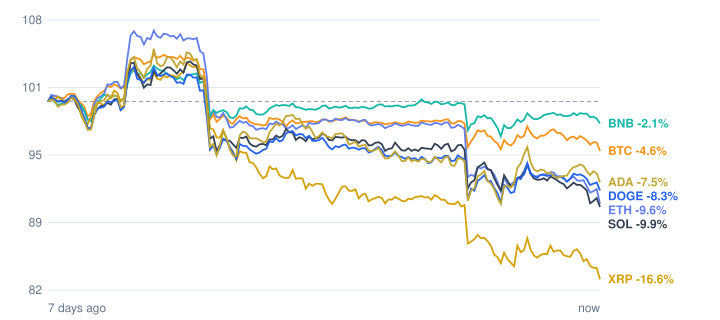

# Crypto market review: 2026-11-10

Snapshot taken 2026-11-10 16:18 (Europe/Berlin). Prices in EUR from CoinGecko.

## Summary

- **Total crypto market cap:** €2.23 T (▼ -3.59% in 24h, measured in USD)
- **Bitcoin dominance:** 59.7%
- **Best of the tracked coins (24h):** BNB ▲ +0.03%
- **Weakest of the tracked coins (24h):** XRP ▼ -3.77%
- **Week:** 0 of 7 tracked coins are up over 7 days.

## Tracked coins

| Coin | Price | 24h | 7d | 7d range | Market cap |
|---|---:|---:|---:|---:|---:|
| Bitcoin (BTC) | €66,444.00 | ▼ -0.81% | ▼ -3.91% | €65,933.49 – €72,164.29 | €1.34 T |
| Ethereum (ETH) | €1,853.31 | ▼ -2.66% | ▼ -8.96% | €1,847.28 – €2,178.17 | €226.5 B |
| BNB (BNB) | €615.03 | ▲ +0.03% | ▼ -1.37% | €604.05 – €645.37 | €80.9 B |
| XRP (XRP) | €0.9473 | ▼ -3.77% | ▼ -17.37% | €0.9523 – €1.18 | €60.2 B |
| Solana (SOL) | €75.38 | ▼ -3.57% | ▼ -9.68% | €75.22 – €86.58 | €44.6 B |
| Dogecoin (DOGE) | €0.0619 | ▼ -1.43% | ▼ -7.74% | €0.0609 – €0.0694 | €9.7 B |
| Cardano (ADA) | €0.1584 | ▼ -2.27% | ▼ -7.03% | €0.1541 – €0.1788 | €6.0 B |

## Last 7 days (indexed to 100)

---
*Automated data summary. Not financial advice.*
