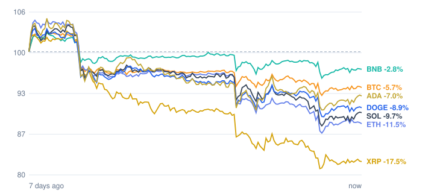

# Crypto market review: 2026-11-11

Snapshot taken 2026-11-11 15:49 (Europe/Berlin). Prices in EUR from CoinGecko.

## Summary

- **Total crypto market cap:** €2.24 T (▼ -2.92% in 24h, measured in USD)
- **Bitcoin dominance:** 59.7%
- **Best of the tracked coins (24h):** Solana ▲ +1.21%
- **Weakest of the tracked coins (24h):** Dogecoin ▼ -0.25%
- **Week:** 0 of 7 tracked coins are up over 7 days.

## Tracked coins

| Coin | Price | 24h | 7d | 7d range | Market cap |
|---|---:|---:|---:|---:|---:|
| Bitcoin (BTC) | €66,409.00 | ▲ +0.32% | ▼ -5.72% | €65,694.88 – €72,755.69 | €1.33 T |
| Ethereum (ETH) | €1,854.12 | ▲ +0.06% | ▼ -11.13% | €1,818.99 – €2,196.02 | €226.4 B |
| BNB (BNB) | €614.04 | ▲ +0.05% | ▼ -2.44% | €604.80 – €650.65 | €80.7 B |
| XRP (XRP) | €0.9536 | ▲ +0.64% | ▼ -17.01% | €0.9403 – €1.19 | €60.5 B |
| Solana (SOL) | €75.96 | ▲ +1.21% | ▼ -8.75% | €73.86 – €87.29 | €44.9 B |
| Dogecoin (DOGE) | €0.0615 | ▼ -0.25% | ▼ -8.47% | €0.0604 – €0.0699 | €9.6 B |
| Cardano (ADA) | €0.1595 | ▲ +1.17% | ▼ -6.36% | €0.1552 – €0.1802 | €6.0 B |

## Last 7 days (indexed to 100)

---
*Automated data summary. Not financial advice.*
