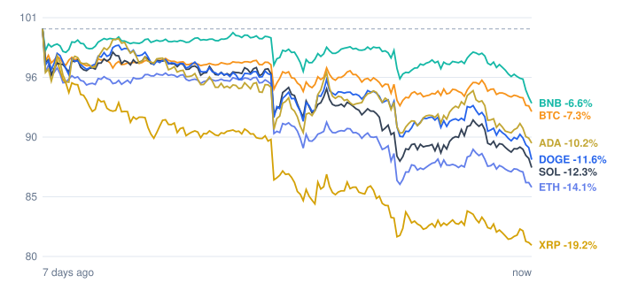

# Crypto market review: 2026-11-12

Snapshot taken 2026-11-12 16:40 (Europe/Berlin). Prices in EUR from CoinGecko.

## Summary

- **Total crypto market cap:** €2.17 T (▼ -5.23% in 24h, measured in USD)
- **Bitcoin dominance:** 59.5%
- **Best of the tracked coins (24h):** Bitcoin ▼ -3.43%
- **Weakest of the tracked coins (24h):** Dogecoin ▼ -5.67%
- **Week:** 0 of 7 tracked coins are up over 7 days.

## Tracked coins

| Coin | Price | 24h | 7d | 7d range | Market cap |
|---|---:|---:|---:|---:|---:|
| Bitcoin (BTC) | €64,477.00 | ▼ -3.43% | ▼ -10.16% | €65,486.31 – €70,678.06 | €1.30 T |
| Ethereum (ETH) | €1,804.73 | ▼ -3.59% | ▼ -16.08% | €1,817.70 – €2,115.55 | €220.5 B |
| BNB (BNB) | €588.90 | ▼ -4.44% | ▼ -8.24% | €592.48 – €634.43 | €77.4 B |
| XRP (XRP) | €0.9218 | ▼ -4.62% | ▼ -21.51% | €0.9340 – €1.16 | €58.5 B |
| Solana (SOL) | €73.18 | ▼ -4.30% | ▼ -14.89% | €73.55 – €83.90 | €43.3 B |
| Dogecoin (DOGE) | €0.0587 | ▼ -5.67% | ▼ -14.29% | €0.0592 – €0.0670 | €9.2 B |
| Cardano (ADA) | €0.1523 | ▼ -5.65% | ▼ -13.00% | €0.1541 – €0.1715 | €5.7 B |

## Last 7 days (indexed to 100)

---
*Automated data summary. Not financial advice.*
