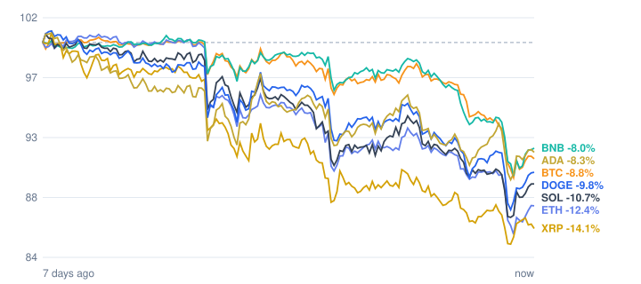

# Crypto market review: 2026-11-13

Snapshot taken 2026-11-13 15:59 (Europe/Berlin). Prices in EUR from CoinGecko.

## Summary

- **Total crypto market cap:** €2.12 T (▼ -5.81% in 24h, measured in USD)
- **Bitcoin dominance:** 58.9%
- **Best of the tracked coins (24h):** Cardano ▲ +2.36%
- **Weakest of the tracked coins (24h):** Bitcoin ▼ -3.43%
- **Week:** 0 of 7 tracked coins are up over 7 days.

## Tracked coins

| Coin | Price | 24h | 7d | 7d range | Market cap |
|---|---:|---:|---:|---:|---:|
| Bitcoin (BTC) | €62,301.00 | ▼ -3.43% | ▼ -8.49% | €61,557.21 – €68,849.72 | €1.25 T |
| Ethereum (ETH) | €1,762.58 | ▼ -2.46% | ▼ -12.04% | €1,726.78 – €2,033.32 | €215.4 B |
| BNB (BNB) | €577.02 | ▼ -1.98% | ▼ -7.42% | €565.62 – €632.56 | €75.9 B |
| XRP (XRP) | €0.9326 | ▲ +0.78% | ▼ -13.08% | €0.9089 – €1.08 | €59.3 B |
| Solana (SOL) | €73.02 | ▼ -0.19% | ▼ -9.58% | €70.84 – €82.19 | €43.2 B |
| Dogecoin (DOGE) | €0.0595 | ▲ +1.31% | ▼ -8.68% | €0.0572 – €0.0661 | €9.3 B |
| Cardano (ADA) | €0.1565 | ▲ +2.36% | ▼ -6.73% | €0.1513 – €0.1701 | €5.9 B |

## Last 7 days (indexed to 100)

---
*Automated data summary. Not financial advice.*
