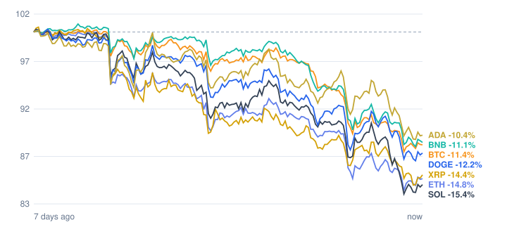

# Crypto market review: 2026-11-14

Snapshot taken 2026-11-14 14:51 (Europe/Berlin). Prices in EUR from CoinGecko.

## Summary

- **Total crypto market cap:** €2.07 T (▼ -5.76% in 24h, measured in USD)
- **Bitcoin dominance:** 58.7%
- **Best of the tracked coins (24h):** XRP ▼ -3.51%
- **Weakest of the tracked coins (24h):** Solana ▼ -7.28%
- **Week:** 0 of 7 tracked coins are up over 7 days.

## Tracked coins

| Coin | Price | 24h | 7d | 7d range | Market cap |
|---|---:|---:|---:|---:|---:|
| Bitcoin (BTC) | €60,587.00 | ▼ -3.78% | ▼ -11.87% | €60,498.46 – €68,930.84 | €1.22 T |
| Ethereum (ETH) | €1,716.40 | ▼ -3.76% | ▼ -15.40% | €1,707.49 – €2,036.19 | €209.8 B |
| BNB (BNB) | €551.43 | ▼ -5.42% | ▼ -11.54% | €556.76 – €634.46 | €72.5 B |
| XRP (XRP) | €0.9037 | ▼ -3.51% | ▼ -15.39% | €0.8909 – €1.06 | €57.4 B |
| Solana (SOL) | €68.57 | ▼ -7.28% | ▼ -15.97% | €68.08 – €81.57 | €40.6 B |
| Dogecoin (DOGE) | €0.0568 | ▼ -5.18% | ▼ -12.83% | €0.0566 – €0.0653 | €8.9 B |
| Cardano (ADA) | €0.1464 | ▼ -6.95% | ▼ -11.60% | €0.1476 – €0.1658 | €5.5 B |

## Last 7 days (indexed to 100)

---
*Automated data summary. Not financial advice.*
