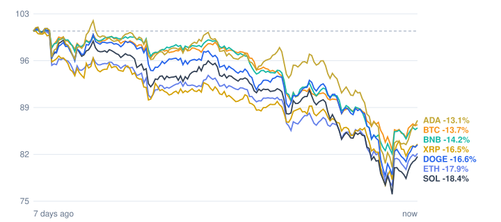

# Crypto market review: 2026-11-15

Snapshot taken 2026-11-15 15:26 (Europe/Berlin). Prices in EUR from CoinGecko.

## Summary

- **Total crypto market cap:** €2.02 T (▼ -4.78% in 24h, measured in USD)
- **Bitcoin dominance:** 58.7%
- **Best of the tracked coins (24h):** Bitcoin ▼ -1.20%
- **Weakest of the tracked coins (24h):** Dogecoin ▼ -3.63%
- **Week:** 0 of 7 tracked coins are up over 7 days.

## Tracked coins

| Coin | Price | 24h | 7d | 7d range | Market cap |
|---|---:|---:|---:|---:|---:|
| Bitcoin (BTC) | €59,252.00 | ▼ -1.20% | ▼ -13.76% | €56,801.64 – €68,934.59 | €1.19 T |
| Ethereum (ETH) | €1,652.55 | ▼ -1.81% | ▼ -18.09% | €1,568.72 – €2,031.28 | €202.0 B |
| BNB (BNB) | €538.90 | ▼ -1.29% | ▼ -14.48% | €518.13 – €632.61 | €70.9 B |
| XRP (XRP) | €0.8774 | ▼ -1.42% | ▼ -16.57% | €0.8147 – €1.05 | €55.7 B |
| Solana (SOL) | €65.49 | ▼ -2.96% | ▼ -18.77% | €61.56 – €81.29 | €38.7 B |
| Dogecoin (DOGE) | €0.0536 | ▼ -3.63% | ▼ -16.73% | €0.0509 – €0.0647 | €8.4 B |
| Cardano (ADA) | €0.1403 | ▼ -2.28% | ▼ -13.72% | €0.1304 – €0.1654 | €5.3 B |

## Last 7 days (indexed to 100)

---
*Automated data summary. Not financial advice.*
