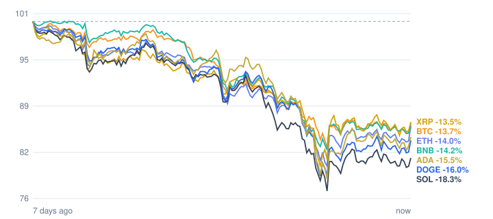

# Crypto market review: 2026-11-16

Snapshot taken 2026-11-16 17:37 (Europe/Berlin). Prices in EUR from CoinGecko.

## Summary

- **Total crypto market cap:** €2.01 T (▼ -1.35% in 24h, measured in USD)
- **Bitcoin dominance:** 58.5%
- **Best of the tracked coins (24h):** Dogecoin ▲ +1.55%
- **Weakest of the tracked coins (24h):** Solana ▼ -0.32%
- **Week:** 0 of 7 tracked coins are up over 7 days.

## Tracked coins

| Coin | Price | 24h | 7d | 7d range | Market cap |
|---|---:|---:|---:|---:|---:|
| Bitcoin (BTC) | €58,732.00 | ▲ +0.26% | ▼ -13.82% | €56,880.81 – €68,557.00 | €1.18 T |
| Ethereum (ETH) | €1,657.70 | ▲ +0.75% | ▼ -14.44% | €1,570.91 – €1,949.44 | €202.6 B |
| BNB (BNB) | €535.57 | ▲ +0.03% | ▼ -14.44% | €518.86 – €627.35 | €70.4 B |
| XRP (XRP) | €0.8685 | ▲ +0.53% | ▼ -13.36% | €0.8158 – €1.01 | €55.2 B |
| Solana (SOL) | €64.57 | ▼ -0.32% | ▼ -18.80% | €61.64 – €79.81 | €38.2 B |
| Dogecoin (DOGE) | €0.0538 | ▲ +1.55% | ▼ -16.19% | €0.0510 – €0.0643 | €8.4 B |
| Cardano (ADA) | €0.1388 | ▼ -0.04% | ▼ -15.91% | €0.1306 – €0.1656 | €5.2 B |

## Last 7 days (indexed to 100)

---
*Automated data summary. Not financial advice.*
