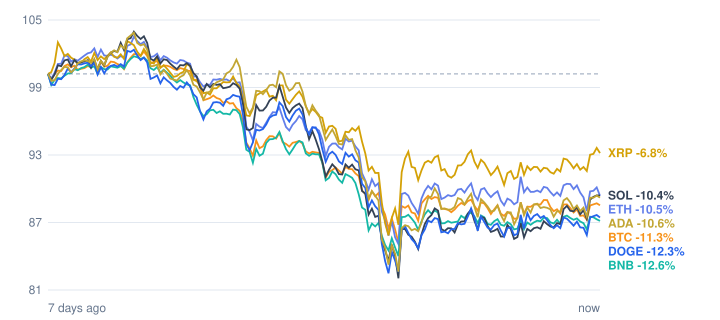

# Crypto market review: 2026-11-17

Snapshot taken 2026-11-17 17:34 (Europe/Berlin). Prices in EUR from CoinGecko.

## Summary

- **Total crypto market cap:** €1.99 T (▼ -3.16% in 24h, measured in USD)
- **Bitcoin dominance:** 58.4%
- **Best of the tracked coins (24h):** Solana ▲ +1.93%
- **Weakest of the tracked coins (24h):** Ethereum ▼ -2.47%
- **Week:** 0 of 7 tracked coins are up over 7 days.

## Tracked coins

| Coin | Price | 24h | 7d | 7d range | Market cap |
|---|---:|---:|---:|---:|---:|
| Bitcoin (BTC) | €57,965.00 | ▼ -1.29% | ▼ -14.05% | €56,856.33 – €67,752.78 | €1.17 T |
| Ethereum (ETH) | €1,615.56 | ▼ -2.47% | ▼ -14.79% | €1,570.23 – €1,897.38 | €197.5 B |
| BNB (BNB) | €532.01 | ▼ -0.62% | ▼ -15.00% | €518.63 – €624.08 | €70.0 B |
| XRP (XRP) | €0.8716 | ▲ +0.48% | ▼ -10.13% | €0.8155 – €0.9734 | €55.4 B |
| Solana (SOL) | €65.72 | ▲ +1.93% | ▼ -14.37% | €61.62 – €77.44 | €38.9 B |
| Dogecoin (DOGE) | €0.0531 | ▼ -1.27% | ▼ -16.12% | €0.0509 – €0.0627 | €8.3 B |
| Cardano (ADA) | €0.1381 | ▼ -0.33% | ▼ -14.55% | €0.1305 – €0.1628 | €5.2 B |

## Last 7 days (indexed to 100)

---
*Automated data summary. Not financial advice.*
