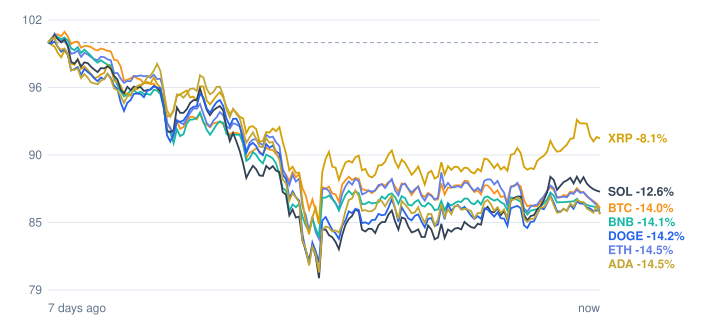

# Crypto market review: 2026-11-18

Snapshot taken 2026-11-18 17:03 (Europe/Berlin). Prices in EUR from CoinGecko.

## Summary

- **Total crypto market cap:** €1.98 T (▼ -3.66% in 24h, measured in USD)
- **Bitcoin dominance:** 58.1%
- **Best of the tracked coins (24h):** XRP ▲ +1.75%
- **Weakest of the tracked coins (24h):** Bitcoin ▼ -1.48%
- **Week:** 0 of 7 tracked coins are up over 7 days.

## Tracked coins

| Coin | Price | 24h | 7d | 7d range | Market cap |
|---|---:|---:|---:|---:|---:|
| Bitcoin (BTC) | €57,457.00 | ▼ -1.48% | ▼ -14.08% | €57,095.65 – €68,037.96 | €1.16 T |
| Ethereum (ETH) | €1,609.90 | ▼ -0.88% | ▼ -13.85% | €1,576.84 – €1,905.36 | €196.8 B |
| BNB (BNB) | €530.20 | ▼ -0.74% | ▼ -14.35% | €520.82 – €626.70 | €69.7 B |
| XRP (XRP) | €0.8893 | ▲ +1.75% | ▼ -7.40% | €0.8189 – €0.9775 | €56.5 B |
| Solana (SOL) | €66.84 | ▲ +1.37% | ▼ -12.40% | €61.88 – €77.77 | €39.6 B |
| Dogecoin (DOGE) | €0.0535 | ▲ +0.68% | ▼ -13.65% | €0.0512 – €0.0630 | €8.4 B |
| Cardano (ADA) | €0.1375 | ▼ -0.65% | ▼ -14.63% | €0.1311 – €0.1635 | €5.2 B |

## Last 7 days (indexed to 100)

---
*Automated data summary. Not financial advice.*
