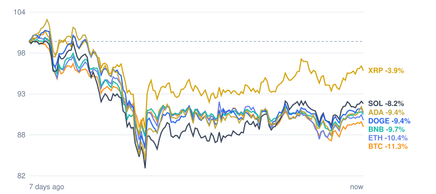

# Crypto market review: 2026-11-19

Snapshot taken 2026-11-19 17:10 (Europe/Berlin). Prices in EUR from CoinGecko.

## Summary

- **Total crypto market cap:** €1.98 T (▼ -2.75% in 24h, measured in USD)
- **Bitcoin dominance:** 58.1%
- **Best of the tracked coins (24h):** Cardano ▲ +0.66%
- **Weakest of the tracked coins (24h):** XRP ▼ -0.81%
- **Week:** 0 of 7 tracked coins are up over 7 days.

## Tracked coins

| Coin | Price | 24h | 7d | 7d range | Market cap |
|---|---:|---:|---:|---:|---:|
| Bitcoin (BTC) | €57,351.00 | ▼ -0.17% | ▼ -11.91% | €56,631.55 – €65,437.02 | €1.15 T |
| Ethereum (ETH) | €1,616.27 | ▲ +0.25% | ▼ -11.18% | €1,574.87 – €1,837.31 | €197.6 B |
| BNB (BNB) | €533.45 | ▲ +0.61% | ▼ -10.20% | €520.16 – €597.71 | €70.2 B |
| XRP (XRP) | €0.8832 | ▼ -0.81% | ▼ -5.45% | €0.8179 – €0.9473 | €56.1 B |
| Solana (SOL) | €66.91 | ▼ -0.06% | ▼ -9.24% | €61.80 – €74.35 | €39.6 B |
| Dogecoin (DOGE) | €0.0533 | ▼ -0.47% | ▼ -9.90% | €0.0511 – €0.0605 | €8.4 B |
| Cardano (ADA) | €0.1385 | ▲ +0.66% | ▼ -9.94% | €0.1309 – €0.1596 | €5.2 B |

## Last 7 days (indexed to 100)

---
*Automated data summary. Not financial advice.*
