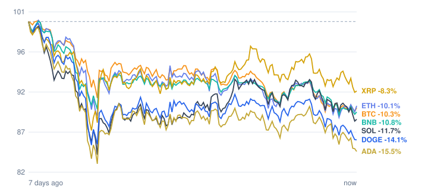

# Crypto market review: 2026-11-20

Snapshot taken 2026-11-20 16:50 (Europe/Berlin). Prices in EUR from CoinGecko.

## Summary

- **Total crypto market cap:** €1.87 T (▼ -8.47% in 24h, measured in USD)
- **Bitcoin dominance:** 58.0%
- **Best of the tracked coins (24h):** Bitcoin ▼ -5.30%
- **Weakest of the tracked coins (24h):** Cardano ▼ -8.12%
- **Week:** 0 of 7 tracked coins are up over 7 days.

## Tracked coins

| Coin | Price | 24h | 7d | 7d range | Market cap |
|---|---:|---:|---:|---:|---:|
| Bitcoin (BTC) | €54,190.00 | ▼ -5.30% | ▼ -11.28% | €55,900.34 – €62,749.28 | €1.09 T |
| Ethereum (ETH) | €1,504.27 | ▼ -6.89% | ▼ -11.48% | €1,569.27 – €1,775.04 | €183.9 B |
| BNB (BNB) | €497.43 | ▼ -6.57% | ▼ -11.60% | €515.53 – €580.28 | €65.4 B |
| XRP (XRP) | €0.8233 | ▼ -6.31% | ▼ -8.75% | €0.8168 – €0.9388 | €52.3 B |
| Solana (SOL) | €61.88 | ▼ -7.59% | ▼ -12.96% | €61.71 – €73.38 | €36.6 B |
| Dogecoin (DOGE) | €0.0488 | ▼ -8.10% | ▼ -14.77% | €0.0510 – €0.0598 | €7.7 B |
| Cardano (ADA) | €0.1270 | ▼ -8.12% | ▼ -15.70% | €0.1307 – €0.1575 | €4.8 B |

## Last 7 days (indexed to 100)

---
*Automated data summary. Not financial advice.*
