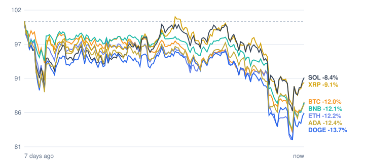

# Crypto market review: 2026-11-21

Snapshot taken 2026-11-21 15:59 (Europe/Berlin). Prices in EUR from CoinGecko.

## Summary

- **Total crypto market cap:** €1.90 T (▼ -4.82% in 24h, measured in USD)
- **Bitcoin dominance:** 58.0%
- **Best of the tracked coins (24h):** Solana ▼ -0.30%
- **Weakest of the tracked coins (24h):** BNB ▼ -3.79%
- **Week:** 0 of 7 tracked coins are up over 7 days.

## Tracked coins

| Coin | Price | 24h | 7d | 7d range | Market cap |
|---|---:|---:|---:|---:|---:|
| Bitcoin (BTC) | €54,891.00 | ▼ -2.21% | ▼ -9.69% | €50,794.40 – €60,892.25 | €1.10 T |
| Ethereum (ETH) | €1,537.64 | ▼ -2.93% | ▼ -10.48% | €1,421.40 – €1,725.04 | €188.0 B |
| BNB (BNB) | €498.08 | ▼ -3.79% | ▼ -10.88% | €464.38 – €553.53 | €65.5 B |
| XRP (XRP) | €0.8471 | ▼ -1.20% | ▼ -6.29% | €0.7939 – €0.9135 | €53.8 B |
| Solana (SOL) | €64.33 | ▼ -0.30% | ▼ -6.48% | €59.59 – €68.82 | €38.1 B |
| Dogecoin (DOGE) | €0.0504 | ▼ -1.59% | ▼ -11.92% | €0.0469 – €0.0570 | €7.9 B |
| Cardano (ADA) | €0.1318 | ▼ -1.02% | ▼ -11.25% | €0.1228 – €0.1466 | €5.0 B |

## Last 7 days (indexed to 100)

---
*Automated data summary. Not financial advice.*
