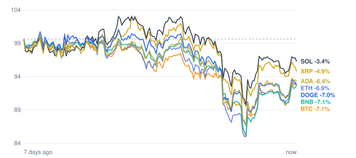

# Crypto market review: 2026-11-22

Snapshot taken 2026-11-22 15:57 (Europe/Berlin). Prices in EUR from CoinGecko.

## Summary

- **Total crypto market cap:** €1.92 T (▼ -2.18% in 24h, measured in USD)
- **Bitcoin dominance:** 58.0%
- **Best of the tracked coins (24h):** BNB ▲ +2.05%
- **Weakest of the tracked coins (24h):** XRP ▼ -0.56%
- **Week:** 0 of 7 tracked coins are up over 7 days.

## Tracked coins

| Coin | Price | 24h | 7d | 7d range | Market cap |
|---|---:|---:|---:|---:|---:|
| Bitcoin (BTC) | €55,492.00 | ▲ +1.08% | ▼ -7.35% | €50,794.12 – €59,650.51 | €1.12 T |
| Ethereum (ETH) | €1,559.49 | ▲ +1.51% | ▼ -7.25% | €1,421.40 – €1,683.14 | €190.6 B |
| BNB (BNB) | €508.23 | ▲ +2.05% | ▼ -7.23% | €464.38 – €544.17 | €66.8 B |
| XRP (XRP) | €0.8422 | ▼ -0.56% | ▼ -5.00% | €0.7939 – €0.9135 | €53.5 B |
| Solana (SOL) | €64.04 | ▼ -0.44% | ▼ -3.84% | €59.59 – €68.50 | €37.9 B |
| Dogecoin (DOGE) | €0.0502 | ▼ -0.36% | ▼ -7.49% | €0.0469 – €0.0548 | €7.9 B |
| Cardano (ADA) | €0.1317 | ▼ -0.09% | ▼ -7.47% | €0.1228 – €0.1419 | €4.9 B |

## Last 7 days (indexed to 100)

---
*Automated data summary. Not financial advice.*
