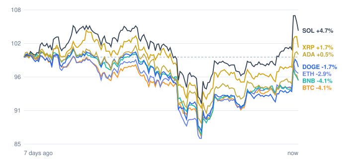

# Crypto market review: 2026-11-23

Snapshot taken 2026-11-23 19:51 (Europe/Berlin). Prices in EUR from CoinGecko.

## Summary

- **Total crypto market cap:** €1.96 T (▼ -0.16% in 24h, measured in USD)
- **Bitcoin dominance:** 57.9%
- **Best of the tracked coins (24h):** Solana ▲ +5.04%
- **Weakest of the tracked coins (24h):** BNB ▲ +1.07%
- **Week:** 1 of 7 tracked coins are up over 7 days.

## Tracked coins

| Coin | Price | 24h | 7d | 7d range | Market cap |
|---|---:|---:|---:|---:|---:|
| Bitcoin (BTC) | €56,356.00 | ▲ +1.93% | ▼ -5.02% | €51,160.59 – €59,952.26 | €1.13 T |
| Ethereum (ETH) | €1,596.99 | ▲ +2.25% | ▼ -4.71% | €1,431.65 – €1,684.00 | €195.2 B |
| BNB (BNB) | €514.09 | ▲ +1.07% | ▼ -4.93% | €467.73 – €548.10 | €67.6 B |
| XRP (XRP) | €0.8726 | ▲ +3.09% | ▼ -0.31% | €0.7996 – €0.9201 | €55.4 B |
| Solana (SOL) | €67.31 | ▲ +5.04% | ▲ +3.09% | €60.02 – €70.16 | €39.9 B |
| Dogecoin (DOGE) | €0.0525 | ▲ +4.40% | ▼ -3.87% | €0.0472 – €0.0552 | €8.2 B |
| Cardano (ADA) | €0.1379 | ▲ +4.96% | ▼ -1.82% | €0.1237 – €0.1429 | €5.2 B |

## Last 7 days (indexed to 100)

---
*Automated data summary. Not financial advice.*
