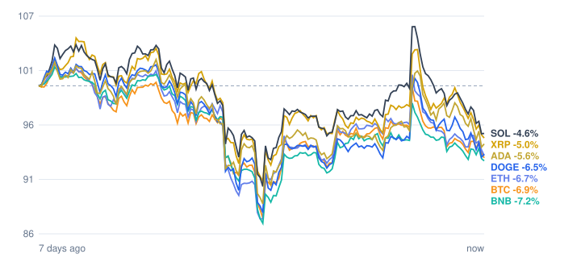

# Crypto market review: 2026-11-24

Snapshot taken 2026-11-24 19:28 (Europe/Berlin). Prices in EUR from CoinGecko.

## Summary

- **Total crypto market cap:** €1.90 T (▼ -5.12% in 24h, measured in USD)
- **Bitcoin dominance:** 57.9%
- **Best of the tracked coins (24h):** BNB ▼ -2.73%
- **Weakest of the tracked coins (24h):** Solana ▼ -6.18%
- **Week:** 0 of 7 tracked coins are up over 7 days.

## Tracked coins

| Coin | Price | 24h | 7d | 7d range | Market cap |
|---|---:|---:|---:|---:|---:|
| Bitcoin (BTC) | €54,730.00 | ▼ -3.22% | ▼ -5.75% | €50,791.99 – €59,159.52 | €1.10 T |
| Ethereum (ETH) | €1,534.71 | ▼ -4.27% | ▼ -5.26% | €1,421.34 – €1,661.98 | €187.6 B |
| BNB (BNB) | €501.52 | ▼ -2.73% | ▼ -5.95% | €464.36 – €544.15 | €65.9 B |
| XRP (XRP) | €0.8416 | ▼ -3.81% | ▼ -3.46% | €0.7939 – €0.9134 | €53.4 B |
| Solana (SOL) | €63.43 | ▼ -6.18% | ▼ -3.41% | €59.58 – €69.65 | €37.5 B |
| Dogecoin (DOGE) | €0.0504 | ▼ -4.31% | ▼ -4.82% | €0.0469 – €0.0548 | €7.9 B |
| Cardano (ADA) | €0.1325 | ▼ -4.30% | ▼ -3.81% | €0.1228 – €0.1419 | €5.0 B |

## Last 7 days (indexed to 100)

---
*Automated data summary. Not financial advice.*
