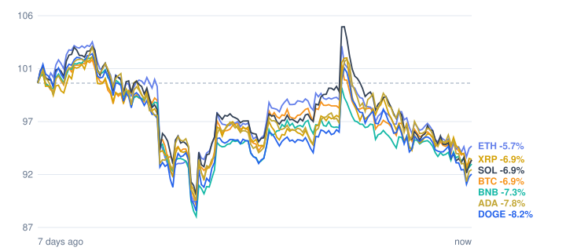

# Crypto market review: 2026-11-25

Snapshot taken 2026-11-25 18:42 (Europe/Berlin). Prices in EUR from CoinGecko.

## Summary

- **Total crypto market cap:** €1.88 T (▼ -2.58% in 24h, measured in USD)
- **Bitcoin dominance:** 57.8%
- **Best of the tracked coins (24h):** XRP ▼ -0.44%
- **Weakest of the tracked coins (24h):** Cardano ▼ -1.86%
- **Week:** 0 of 7 tracked coins are up over 7 days.

## Tracked coins

| Coin | Price | 24h | 7d | 7d range | Market cap |
|---|---:|---:|---:|---:|---:|
| Bitcoin (BTC) | €54,186.00 | ▼ -0.92% | ▼ -7.29% | €50,719.11 – €58,245.02 | €1.09 T |
| Ethereum (ETH) | €1,520.34 | ▼ -0.94% | ▼ -7.05% | €1,419.30 – €1,649.16 | €185.9 B |
| BNB (BNB) | €497.91 | ▼ -0.55% | ▼ -7.44% | €463.69 – €539.61 | €65.5 B |
| XRP (XRP) | €0.8376 | ▼ -0.44% | ▼ -7.22% | €0.7927 – €0.9034 | €53.2 B |
| Solana (SOL) | €62.81 | ▼ -0.90% | ▼ -7.74% | €59.50 – €69.55 | €37.2 B |
| Dogecoin (DOGE) | €0.0498 | ▼ -1.40% | ▼ -8.78% | €0.0468 – €0.0544 | €7.8 B |
| Cardano (ADA) | €0.1301 | ▼ -1.86% | ▼ -7.18% | €0.1226 – €0.1417 | €4.9 B |

## Last 7 days (indexed to 100)

---
*Automated data summary. Not financial advice.*
