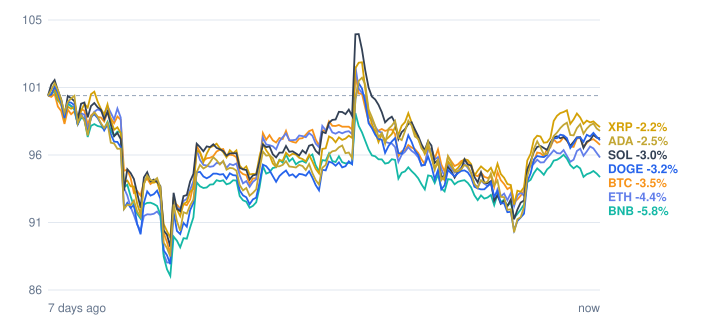

# Crypto market review: 2026-11-26

Snapshot taken 2026-11-26 18:25 (Europe/Berlin). Prices in EUR from CoinGecko.

## Summary

- **Total crypto market cap:** €1.91 T (▲ +0.11% in 24h, measured in USD)
- **Bitcoin dominance:** 57.9%
- **Best of the tracked coins (24h):** Cardano ▲ +4.74%
- **Weakest of the tracked coins (24h):** BNB ▲ +1.48%
- **Week:** 0 of 7 tracked coins are up over 7 days.

## Tracked coins

| Coin | Price | 24h | 7d | 7d range | Market cap |
|---|---:|---:|---:|---:|---:|
| Bitcoin (BTC) | €55,123.00 | ▲ +2.42% | ▼ -4.08% | €50,783.54 – €58,062.99 | €1.11 T |
| Ethereum (ETH) | €1,542.43 | ▲ +2.21% | ▼ -5.00% | €1,421.10 – €1,645.37 | €188.6 B |
| BNB (BNB) | €502.64 | ▲ +1.48% | ▼ -5.93% | €464.28 – €534.27 | €66.1 B |
| XRP (XRP) | €0.8661 | ▲ +3.79% | ▼ -1.99% | €0.7937 – €0.9036 | €55.0 B |
| Solana (SOL) | €64.64 | ▲ +3.44% | ▼ -3.56% | €59.57 – €69.64 | €38.3 B |
| Dogecoin (DOGE) | €0.0517 | ▲ +4.21% | ▼ -3.20% | €0.0469 – €0.0537 | €8.1 B |
| Cardano (ADA) | €0.1357 | ▲ +4.74% | ▼ -2.41% | €0.1228 – €0.1404 | €5.1 B |

## Last 7 days (indexed to 100)

---
*Automated data summary. Not financial advice.*
