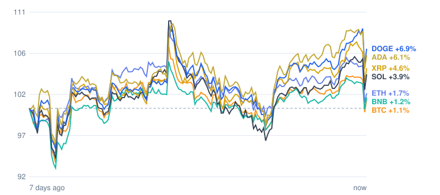

# Crypto market review: 2026-11-27

Snapshot taken 2026-11-27 18:04 (Europe/Berlin). Prices in EUR from CoinGecko.

## Summary

- **Total crypto market cap:** €1.91 T (▼ -2.99% in 24h, measured in USD)
- **Bitcoin dominance:** 57.8%
- **Best of the tracked coins (24h):** Solana ▲ +1.80%
- **Weakest of the tracked coins (24h):** Ethereum ▼ -1.05%
- **Week:** 7 of 7 tracked coins are up over 7 days.

## Tracked coins

| Coin | Price | 24h | 7d | 7d range | Market cap |
|---|---:|---:|---:|---:|---:|
| Bitcoin (BTC) | €54,761.00 | ▼ -0.70% | ▲ +1.04% | €50,934.43 – €58,235.51 | €1.10 T |
| Ethereum (ETH) | €1,524.95 | ▼ -1.05% | ▲ +1.21% | €1,425.32 – €1,650.26 | €186.6 B |
| BNB (BNB) | €504.50 | ▲ +0.41% | ▲ +1.29% | €465.66 – €527.28 | €66.4 B |
| XRP (XRP) | €0.8669 | ▲ +0.21% | ▲ +4.47% | €0.7961 – €0.9063 | €55.1 B |
| Solana (SOL) | €65.82 | ▲ +1.80% | ▲ +5.64% | €59.75 – €69.85 | €39.0 B |
| Dogecoin (DOGE) | €0.0526 | ▲ +1.79% | ▲ +7.08% | €0.0470 – €0.0539 | €8.3 B |
| Cardano (ADA) | €0.1360 | ▲ +0.16% | ▲ +6.49% | €0.1232 – €0.1408 | €5.1 B |

## Last 7 days (indexed to 100)

---
*Automated data summary. Not financial advice.*
