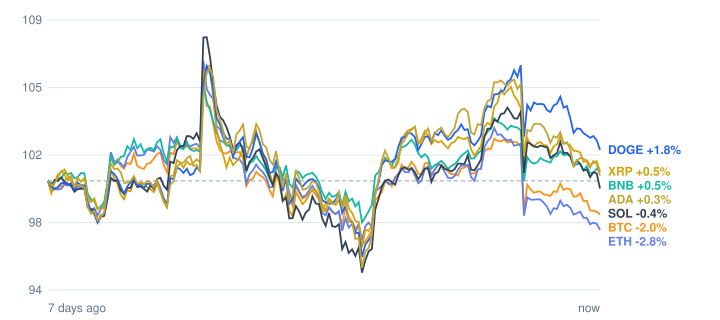

# Crypto market review: 2026-11-28

Snapshot taken 2026-11-28 16:53 (Europe/Berlin). Prices in EUR from CoinGecko.

## Summary

- **Total crypto market cap:** €1.89 T (▼ -2.71% in 24h, measured in USD)
- **Bitcoin dominance:** 57.7%
- **Best of the tracked coins (24h):** BNB ▼ -0.17%
- **Weakest of the tracked coins (24h):** Cardano ▼ -2.14%
- **Week:** 4 of 7 tracked coins are up over 7 days.

## Tracked coins

| Coin | Price | 24h | 7d | 7d range | Market cap |
|---|---:|---:|---:|---:|---:|
| Bitcoin (BTC) | €54,330.00 | ▼ -0.95% | ▼ -2.06% | €52,997.18 – €58,190.28 | €1.09 T |
| Ethereum (ETH) | €1,506.96 | ▼ -1.32% | ▼ -3.21% | €1,489.14 – €1,648.98 | €184.2 B |
| BNB (BNB) | €504.65 | ▼ -0.17% | ▲ +0.62% | €487.22 – €526.87 | €66.4 B |
| XRP (XRP) | €0.8599 | ▼ -1.05% | ▲ +0.95% | €0.8163 – €0.9056 | €54.6 B |
| Solana (SOL) | €64.54 | ▼ -1.89% | ▼ -0.30% | €61.01 – €69.79 | €38.2 B |
| Dogecoin (DOGE) | €0.0516 | ▼ -2.13% | ▲ +2.32% | €0.0483 – €0.0539 | €8.1 B |
| Cardano (ADA) | €0.1329 | ▼ -2.14% | ▲ +1.42% | €0.1254 – €0.1407 | €5.0 B |

## Last 7 days (indexed to 100)

---
*Automated data summary. Not financial advice.*
